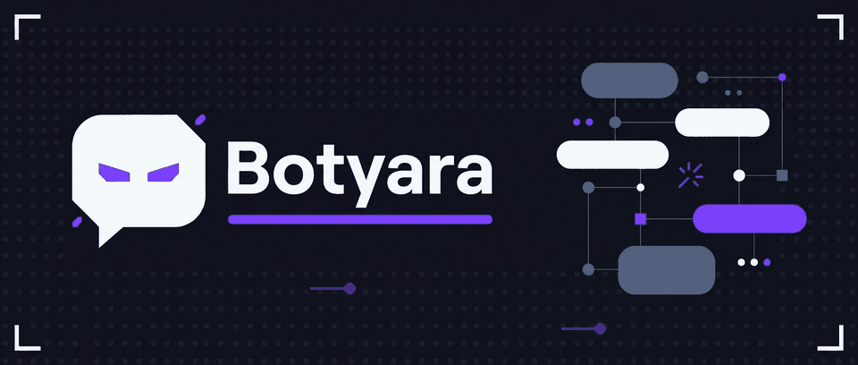
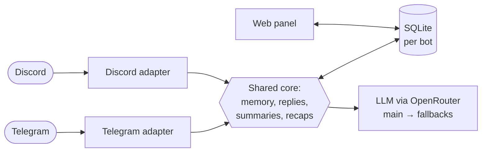

<p align="center">
  
</p>

<h3 align="center">A group chat member for Telegram and Discord that remembers the whole conversation</h3>

<p align="center">
  Jokes on topic, answers when called, posts a weekly recap, and remembers who promised what a month ago.
</p>

<p align="center">
  <a href="docs/assets/avatar.png">Bot avatar</a> · <a href="docs/assets/telegram-description.mp4">Telegram description video</a>
</p>

<p align="center">
  
  
  
  
  
  
  
  
  <a href="LICENSE"></a>
</p>

<p align="center">
  <a href="https://github.com/dzotyara/botyara"></a>
  <a href="https://boosty.to/dzotyara"></a>
</p>

<p align="center">
  <b>If Botyara fits in your chat, <a href="https://github.com/dzotyara/botyara">give it a star</a>.</b> It helps other people find it.
</p>

---

**Botyara knows the whole context of the chat.** Every message goes into a database, and old
conversations get folded into a summary. So the bot remembers who wrote, promised or argued what,
and how it ended, and can bring it up at the right moment. It is not an assistant. It is one of
the regulars: it does not comment on every message, but it always answers when you call it.

The default persona speaks Russian. You can rewrite it in any language from the web panel or in
`prompts/`.

## Features

- **Remembers the whole conversation.** Sees the latest messages word for word, everything older
  as a compact summary, and pulls up what each member said before by their ID: "last week you said
  the opposite".
- **Always answers when called:** an @mention, a reply to its message, or its name without @
  (any Russian case form of "ботяра"). If the model is down, it still answers instead of going quiet.
- **Talks like a person, not like an assistant:** usually one or two sentences, longer only when
  someone asks a real question.
- **Lives in the chat on its own:** drops a line or a reaction now and then when there is a reason.
  Empty "ok" messages and stickers cost zero model calls. In a busy chat the bot first does a cheap
  check on the last few lines, and only reads the full memory if there is something to say.
- **Weekly recap** on Sundays at 20:00 Moscow time. In Discord also on demand with `/digest`.
- **Discord: reads the history itself.** On first start the bot can load the last `BACKFILL_DAYS`
  days of the channel and fold them into memory. Three months of a busy channel is tens of thousands
  of messages and real money (around a dollar), so `0` means do not load. Telegram does not give
  bots the history, so there memory starts from launch.
- **Web panel:** persona and house rules, pause, names, channels, models and providers, reply
  length, delays, memory size, summary, moderators, memory, daily spending with a chart and the
  moderation log. No restart needed.
- **Draws on request:** "ботяра, draw a cat in a tank", and a few seconds later there is a picture
  with a caption in the bot's voice. Drawing uses the free Cloudflare Workers AI tier (~170 images a
  day), one at a time, the rest wait in a queue. When the quota runs out, the bot says when it resets.
  In the panel you can turn on fallback generators (Pollinations) and a paid OpenRouter model with a
  daily limit.
- **Discord: moderation on request.** A moderator writes to the bot in plain text, for example
  "change Ivoxy's nickname to Anton, role Marine, color khaki", and the bot changes the nickname,
  creates or recolors the role and assigns it. Same for timed mutes, kicks and bans ("mute Vasya for
  an hour", "ban Vasya"). Before a kick or a ban the bot asks again. It never touches moderators or
  the server owner. Moderators are set in the panel; requests from everyone else are ignored.
- **Any model:** runs on LLMs through OpenRouter, can run fully on free models. If a model is down
  or the credits run out, the bot moves to the next one in the list.

## Web panel

The panel UI is in Russian.

<p align="center">
  
</p>

<table>
  <tr>
    <td width="33%"></td>
    <td width="33%"></td>
    <td width="33%"></td>
  </tr>
  <tr>
    <td align="center">Persona: the text that sets the bot's personality</td>
    <td align="center">All settings: channels, moderators, models, memory, images</td>
    <td align="center">Memory: the summary and the latest messages</td>
  </tr>
</table>

<table>
  <tr>
    <td width="50%"></td>
    <td width="50%"></td>
  </tr>
  <tr>
    <td align="center">Spending: daily chart, where the money went, providers and cache</td>
    <td align="center">Moderation: who asked for what and what the bot did</td>
  </tr>
</table>

The **Spending** page shows a daily chart for 7, 30 or 90 days: where the money went (replies,
prechecks, summary, images, moderation), which provider answered, how fast, and how much input came
from cache. The Discord bot also has a **Moderation** tab: who asked for what and what the bot did.

The switch puts the bot **on pause**: it keeps reading and remembering the chat but does not write
anything. The panel has no login, so it listens only on the server's `127.0.0.1`. Open it through an
SSH tunnel:

```bash
ssh -N -L 8090:127.0.0.1:8090 root@<your-server>
```

Then go to http://localhost:8090. The panel accepts only local addresses, rejects requests from
other sites and never shows tokens or keys.

## How it works



1. The Telegram or Discord adapter saves every message to the database: text, captions, markers
   like `[стикер 😂]` (sticker), edits and the bot's own replies.
2. Messages are grouped into batches and handled after a short pause in the conversation.
3. If a batch calls the bot, it always answers; the model does not decide whether to reply.
   Otherwise the model picks, in character: stay quiet, reply or react. With
   `PRECHECK_CONTEXT_TOKENS` the bot first asks a short "is there a reason?" question on the last
   lines, without memory, and sends the full request only on "yes".
4. The request to the model contains the persona, the **chat memory** (summary), **what regulars and
   the authors of new messages said before**, the messages being replied to, and the **latest
   conversation** word for word, as much as fits the token budget.
5. When messages fall out of the word-for-word window, the model folds them into the summary, so no
   message is lost.

Members are tracked by ID, not by name: `FOCUS_USERS=123456789:Ivan` means this person is always
labeled "Ivan", even after a nickname change, and the bot always has their past messages at hand.

## Commands

**Telegram**

| Command | Who | What it does |
|---|---|---|
| `/help` | everyone | what the bot can do and how to call it |
| `/names` · `/имена` | everyone / owner | which names it answers to; the owner changes them: `/имена бэксит, ботяра` |
| `/id` | everyone | your Telegram ID and the chat ID (needed for setup) |
| `/ping` | everyone | check that the bot is alive |
| `/prompt` · `/промпт` | owner, in DM | show or change the persona: as text, a `.txt` file, or `/промпт сброс` to reset |
| `/status` | owner, in DM | models, memory per chat, spending and limits |

**Discord** (slash commands; only the owner sees the answers to `/prompt` and `/status`)

| Command | Who | What it does |
|---|---|---|
| `/help` | everyone / moderators | who the bot is and how to call it; moderators also get a cheat sheet for nicknames and roles |
| `/names` | everyone / owner | the bot's names; the owner changes them, comma separated |
| `/digest` | everyone | recap of the last 7 days right now (at most once per 10 minutes per channel) |
| `/prompt` | owner | show, change (as text or a file) or reset the persona |
| `/status` | owner | models, memory per channel, spending and limits |

Other members cannot see the persona or the owner commands. The persona says who the bot teases,
so it must not show up in the chat.

## Quick start

1. Copy `.env.example` to `.env` and fill in:
   - `TELEGRAM_BOT_TOKEN`: the token from @BotFather (turn off privacy mode there too: `/setprivacy` → Disable);
   - `OPENROUTER_API_KEY`: your OpenRouter key;
   - `OWNER_IDS` and `ALLOWED_CHAT_IDS`: your ID and the group ID (send `/id` to the bot).
2. For Discord, copy `.env.discord.example` to `.env.discord`. In the Developer Portal:
   - on the **Bot** tab turn on *Message Content Intent*, turn off *Public Bot* and copy the token;
   - on the **Installation** tab keep only *Guild Install*;
   - invite the bot with scopes `bot applications.commands` and the permissions View Channels,
     Send Messages, Send Messages in Threads, Read Message History, Add Reactions.
3. Turn on the services you need in `.env`: `COMPOSE_PROFILES=discord,web`.
4. Start it:

   ```bash
   docker compose up -d --build
   ```

   If compose is a separate tool on your system, use the dashed form: `docker-compose up -d --build`.

Memory lives in `data/` (a separate SQLite database per bot). The default personas are in
`prompts/persona.md` and `prompts/discord.md`; edits to these files are picked up without a rebuild.

## Models and cost

The bot runs on LLMs through OpenRouter. List models in `MODELS` by priority (or in the web panel);
the first available one answers. You can run on free models only (the ones with `:free` in the
name): they allow 50 requests a day, or 1000 if you ever bought $10+ of OpenRouter credits.

On a cheap paid model, a reply with full context costs a fraction of a cent. Most of the spend is the
"should I say something" decision the bot makes at every pause in the conversation: a channel with
~600 messages a day means ~300 decisions. `PRECHECK_CONTEXT_TOKENS=600` first asks the model a short
"is there a reason?" question on the last lines, without memory, and such a channel costs about
$0.09 a day instead of $0.25.

The same model is served by different providers, and their prices differ several times over.
`PROVIDERS` sets which ones to try first; the rest stay as fallbacks. Hidden model reasoning is off
(`REASONING=off`): faster and cheaper.

The prompt is built so that consecutive requests start the same way: persona, memory, the
conversation since the last summary, and only then what changes from batch to batch. Providers that
cache the start of a request charge less for that input. Still, pick a provider by the final price:
the cache does not hit on every request, and a provider whose normal input costs as much as someone
else's cached input comes out cheaper. You can compare providers on your own traffic in the panel,
on the Spending page.

After answering someone, the bot does not answer that person again for `REPLY_FREEZE_SECONDS`
(30 seconds), with a separate timer per person. Call it earlier and you get a short "not ready yet"
(once, with no model call).

## Development

```bash
python -m venv .venv
.venv/Scripts/pip install -r requirements-dev.txt   # Linux/macOS: .venv/bin/pip
.venv/Scripts/python -m pytest
.venv/Scripts/ruff check backseat tests
```

The 295 tests do not touch the network: Telegram, Discord and the model are mocked. The path from an
incoming update to a reply runs through the real aiogram dispatcher, and the panel is tested with the
FastAPI test client.

```text
backseat/
├── telegram/      Telegram adapter: aiogram, commands, sending
├── discord/       Discord adapter: discord.py, slash commands, history backfill
├── web/           web panel: FastAPI + Jinja2, no JavaScript
├── responder.py   when and how to reply: batches, mentions, reactions, pause
├── context.py     what the model sees: persona, memory, history, new messages
├── summarizer.py  summary of older conversation
├── digest.py      weekly recap
├── llm.py         LLM requests with fallback models
├── bot_config.py  persona, names and settings from the panel
├── commands.py    shared command code for both bots: /status, reset, persona from a file
├── storage.py     SQLite: messages, summaries, settings
└── heartbeat.py   liveness and panel defaults
prompts/           default bot personas
```

More for AI agents and developers in [AGENTS.md](AGENTS.md).

## Changelog

**v2.2**

- Spending in the panel: daily chart, where the money went, which provider answered, speed and cache.
- Moderation log: who asked for what and what the bot did, including canceled bans and kicks.
- Replies go through the provider that is faster and cheaper when the cache does not hit.

**v2.1**

- Images on request: "draw a cat in a tank", free through Cloudflare, ~170 a day, with a queue and
  a message saying when the limit resets.
- Discord: moderators change nicknames and roles, mute, kick and ban in plain text (kick and ban ask
  for confirmation); cheat sheet in `/help`.
- All settings in the web panel: channels, moderators, models and providers, reply length, delays,
  memory, house rules, images.
- Short replies, like a person in a chat.
- Cheaper: the "is there a reason?" precheck, cheap providers, a "recent conversation only" mode.

## Support

- **Star the repo.** It is the fastest way to help other people find the project.
- **[Support on Boosty](https://boosty.to/dzotyara).** A one-time donation or a subscription gives me more time for Botyara and new projects.
- **Open an issue** with a bug or an idea.

## Author

Made by [@dzotyara](https://github.com/dzotyara). Ideas and suggestions are welcome.

## License

[MIT](LICENSE): take it, change it and use it, keeping the author credit.
